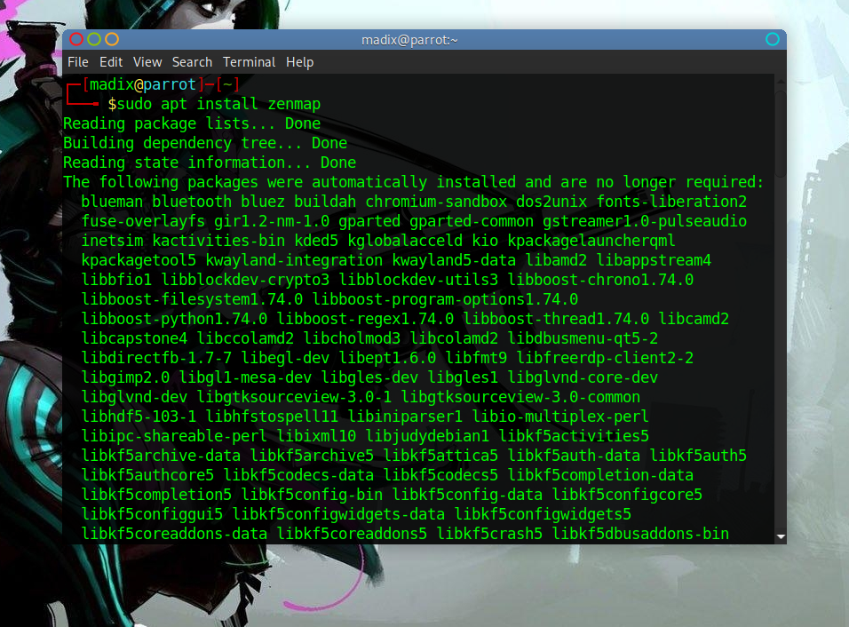
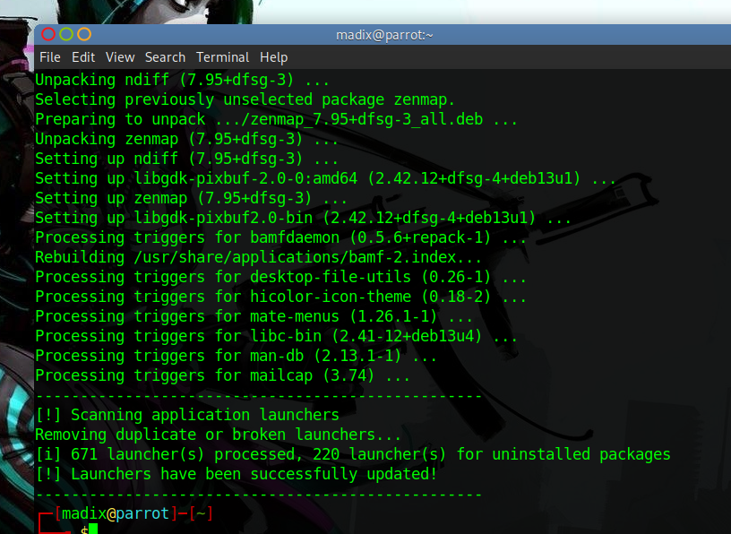
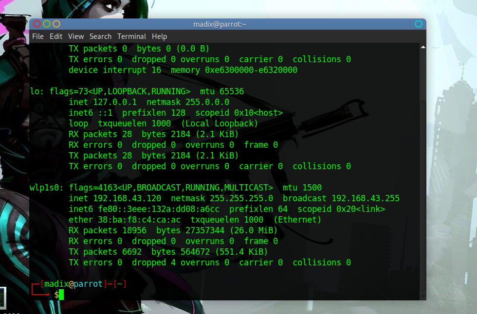
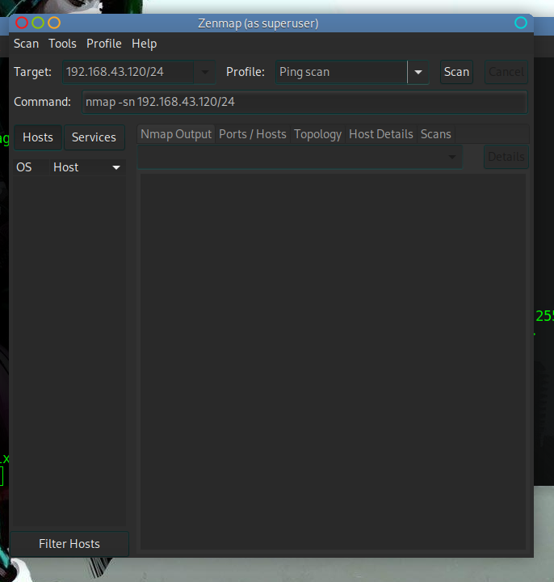
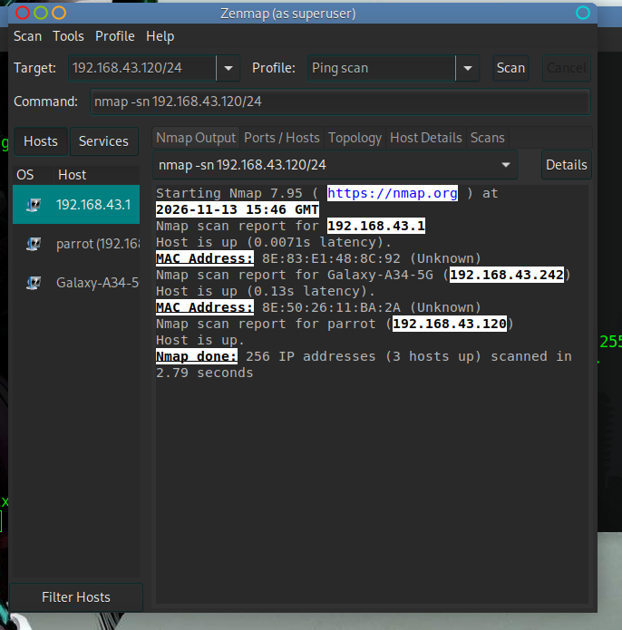
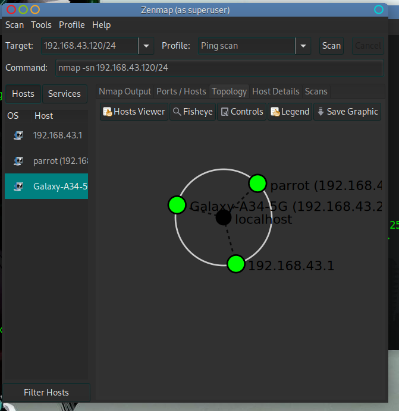
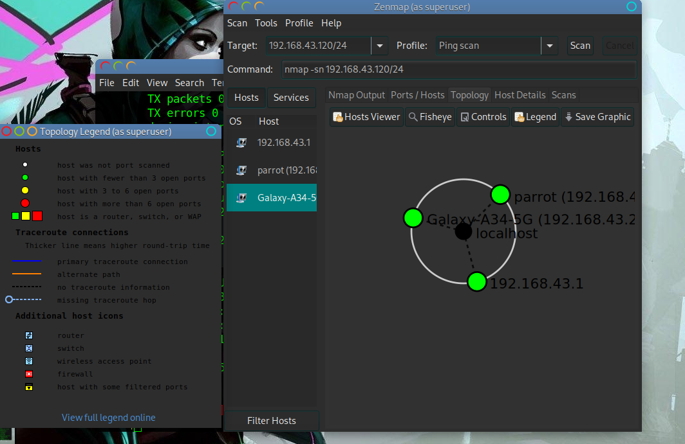
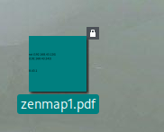

# 🔐 Footprinting And Reconisance

**Making Use Of Zenmap For Footprintig & Reconisance**

  
  
  
  
 
  
  
  
  

<h2>Introduction</h2>

  This labwork made use of nmap's GUI (ZenmaP) to perform some scans as well as to find the number of devices in a network.Zenmap is where you go when you need to discover live hosts, open ports, running services and OS fingerprints with a visual interface that also teaches you the underlying Nmap commands.

<h3>Installation</h3>

  In order to make use of it, Zenmap has to be downloaded from its official website for windows. For some linux distros, you can do the same or just install it in your terminal, like below.

<h3>IP Identification</h3>

  After the installation is complete, Zenmap can then be opened but before than, the IP and Network mask of the host machine(The machine going to run zenmap) is needed. 

<h3>Scanning</h3>

  Zenmap is then opend and the IP and networkmask is typed into the 'Target' textbox. Next to it is  the profile which is changed to 'Ping Scanning' Then the scan button is pressed/clicked

<h3>Device Identification</h3>

  After the scan, Some devices should be displayed along with their IPS and MAC adresses. The Tropology can also be displayed and after that the resluts can be saved
  
  
  
  
  

